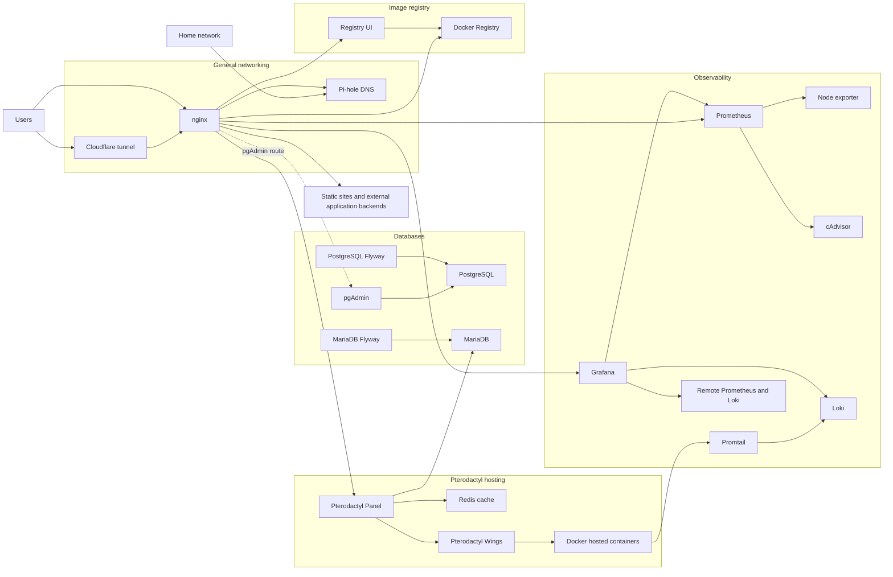

# Home-Server - Infrastructure
A Centralized Configuration for Home-Server Infrastructure

## Principles
* Single Git repository as the source of truth
* No service is configured manually — everything is code
* Shared infrastructure (database, proxy, tunnel, observability) runs once
* Each application service is isolated but connects to shared resources
* Secrets are encrypted at rest and never committed in plaintext

## Current infrastructure

The Compose configuration includes the services listed in the version history above, plus:

- **MariaDB and Flyway** for the Pterodactyl database and its migrations.
- **Pterodactyl Panel, Redis and Wings** for managing hosted servers. Wings uses the host Docker socket to manage containers.
- **Prometheus, node exporter and cAdvisor** for host and container metrics.
- **Promtail and Loki** for collecting Docker container logs, with **Grafana** for viewing metrics and logs. Grafana also has remote Prometheus and Loki data sources configured.
- **nginx static sites and application proxies** for the configured websites and external application backends.

The base stack uses separate bridge networks for shared access, internal services and databases, plus an external `pterodactyl_nw` network. Pi-hole and node exporter use the host network. Production overrides mount Let's Encrypt certificates; staging overrides expose additional service ports.

## Service interactions

The diagram shows configured connections; external backends and the Cloudflare tunnel configuration are managed outside this Compose file. The pgAdmin proxy currently targets `database_pgadmin`, while the Compose service is named `postgresql_pgadmin`, so that route requires alignment to work.

