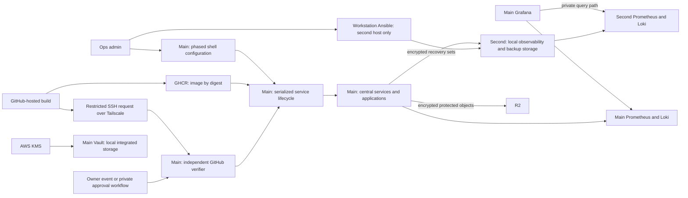
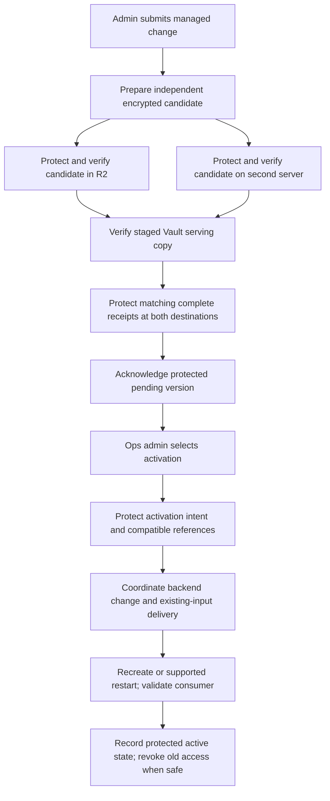

# Home server infrastructure refactor

* **Author:** Server owner, with Codex
* **Status:** Draft — Overview & Goals and Technical Plan approved; Alternatives Considered ready for owner review
* **Date:** 2026-11-02
* **Requirements input:** [Approved concepts brief](concepts_brief.md), including the post-review decisions and private-repository clarification.

## Overview

Make the Debian 13 home server reproducible to administer and recover: application onboarding should establish working database access, deployments should run the authorized artifact, secret changes should be recoverable before they are acknowledged, and routine maintenance should leave useful evidence. The design covers the host configuration and central Docker infrastructure together because the current failures cross that boundary.

Keep the central infrastructure on the existing Atom server. Give the second server its own telemetry ingestion and storage, queried by central Grafana, and use it as a backup destination. Build application images on GitHub-hosted VMs under the delegated placement decision. Every service may be unavailable while the admin investigates or restores it; preserving recoverable data takes priority over continuous availability.

| Location | Agreed role and boundary |
| --- | --- |
| Current server | Atom x5-Z8300, 4 GiB RAM, approximately 64 GB eMMC. Hosts the central infrastructure and existing independently deployed applications. Grafana stays here. |
| Second server | i5-3230M, 8 GiB RAM, 128 GB drive, also used by independent workloads. Receives its own Prometheus, node-exporter, cAdvisor, Loki, and a supported log collector, plus backup storage. It does not receive the rest of the central infrastructure or another Grafana. |
| GitHub-hosted builders | Build and check deployable images without production-host control or runtime secrets. Deployment still targets the current server. Verify included/private-repository allowance and spending controls before relying on this placement. |
| Cloudflare R2 | Off-site encrypted recovery destination, to be configured. Required for protecting secret changes before acknowledgment; database/Pterodactyl outage fallback is specified below. |

The completed design will describe the target configuration, reasons and alternatives, affected files, migration order, validation, and recovery. This first section establishes the required outcomes. Product selection, protocols, version limits, storage allocations, and operational procedures remain for the Technical Plan and Detailed Implementation sections.

## The Problem

The existing shared-database arrangement does not provide a dependable onboarding process. The [ITskolar investigation](docs/investigations/2026-11-01-database-connectivity.md) confirms that its current bot reaches PostgreSQL over DNS/TCP but cannot authenticate: the relevant roles have no passwords, lack database connection privileges, and expected application schemas are absent. Its workflow also does not explicitly select the production Compose override used by the running container. This establishes provisioning and deployment-consistency problems; it does not establish that shared database processes must be replaced. MariaDB and other consumers need their own inventory and validation.

CI already has two self-hosted runners on the production Atom. The owner controls the organizations, but collaborators can push code. Builds and deployments therefore need distinct privileges, and production authorization must bind to the revision and image actually deployed. ITskolar-System is private, as confirmed by the owner. Its billing allowance and available approval mechanisms must be checked rather than inferred from visibility or organization ownership.

The infrastructure also lacks an agreed way to deliver and rotate secrets across central services, separate applications, and Pterodactyl workloads without application/startup-code changes. A successful secret-store write is insufficient for the required zero-loss policy unless the version and recovery material can survive the accepted failures. Automatic image maintenance must preserve the admin's control over activating pending secrets.

Host configuration and operations have drifted from the repository assumptions. The [Debian/Pi-hole baseline](docs/investigations/2026-11-01-debian-host-baseline.md) shows Pi-hole's UI works from the host on port 8080, while nginx's configured upstream request times out; effective firewall rules remain unverified. The faulty custom apt-listchanges hook is installed beside the package hook, and the MOTD script truncates shared history. Live PAM already differs from the faulty setup-script version. Kernel/driver settings, network ownership, certificate renewal, and privileged scheduled work also need evidence before changing them.

Finally, the second server introduces another telemetry and recovery destination without increasing the Atom's RAM or disk. Monitoring, audit retention, backups, image storage, and maintenance peaks need one measured budget on each machine. Existing Grafana state and alert destinations must survive the refactor. The owner accepts interruption of Grafana alerts and already has healthchecks.io server-down checks on both hosts.

## Goals

The following criteria define success for the completed design and its later implementation. They are not claims that the current deployment meets them.

| ID | Required outcome | Evidence of completion |
| --- | --- | --- |
| G-01 | Establish the Debian 13 host baseline and a maintained target. | A redacted inventory separates package/installer defaults, repository intent, effective state, and proposed changes. Each accepted deviation records its reason, apply/reboot needs, affected services, validation, rollback, and drift check. Include packages/repositories, kernel/boot/firmware/drivers, storage, networking, services/access, and scheduled operations. Unknown history remains identified. |
| G-02 | Make PostgreSQL/MariaDB onboarding and migration ownership repeatable. | For each consumer, record endpoint/network, database, runtime identity, provisioning owner, schema-migration owner, and credential source. Validate actual consumer login/schema use and rejection of unauthorized cross-application access. Existing state is adopted safely; runtime apps do not receive shared superuser access to bypass provisioning. Use the shared engines selected in D-22. |
| G-03 | Build remotely and deploy only authorized artifacts to the Atom. | Standard GitHub-hosted VM builds have no production Docker socket, runtime secrets, or general home-network access. An owner-initiated event or explicit owner approval authorizes the deployed revision/artifact. Define rerun semantics, bind approval to artifact identity, use explicit production configuration, and restrict/retire competing old runner paths. Validate this on the actual private-repository plan and allowance. |
| G-04 | Deliver protected secrets through existing application inputs. | Demonstrate central, ITskolar, and relevant Pterodactyl delivery using supported environment/file/deployment interfaces, without application or startup-code changes. Protect each acknowledged change off-site first. Distinguish protected, pending, and active versions; coordinate backend credentials, manual admin activation, and revocation. Image recreation must not activate a pending version. |
| G-05 | Apply compatible central image updates and report other updates. | Maintain an explicit service/policy inventory. Central updates pull and recreate using intended active configuration and data mounts after compatibility/recovery prerequisites pass. Database major upgrades and external/Pterodactyl application updates emit actionable Loki events for existing Grafana alerting, without automatic rollout. Unknown compatibility defers application. Pending/resolved state and failed/stale scans remain observable. |
| G-06 | Observe both hosts while keeping ingestion/storage local to each. | Each server has persistent Prometheus/Loki data and its own exporters/log collection. Central Grafana queries both through a defined authorized path. A surviving host continues local collection during inter-server or Grafana outages. Preserve existing Grafana data, alert rules, contact points, routing, and required encryption configuration through backup/restore validation. |
| G-07 | Restore intended Pi-hole access and home-network services. | Validate the complete permitted LAN browser path to Pi-hole, DNS over TCP/UDP, and NTP. Retain internal administration and database access; external Grafana remains authenticated through existing ingress. Validate DHCP separately, then switch authority from the router in a controlled cutover with a real-client lease test and rollback. Preserve management/recovery networking. |
| G-08 | Make package change reporting useful and durable. | Use the installed apt-listchanges package integration correctly, establish display/reporting behavior before upgrades, and retain change history independently of login. Correct obsolete setup behavior without overwriting already-correct live PAM configuration. A login must not destroy shared upgrade history. |
| G-09 | Establish certificate ownership and renewal behavior. | Inventory certificate consumers, names, issuance/renewal method, credentials, scheduled work, and reload propagation. Validate renewal and consumer reload through the selected supported procedure, record outcomes, and include required recovery material. Absence of one timer alone is not proof that renewal is missing. |
| G-10 | Retain 30 searchable days of meaningful administrative audit history. | Cover package/repository and kernel/driver/configuration changes, state-changing/nonstandard command attempts, access/network changes, service/container/deployment actions, and secret/backup/certificate metadata. Exclude routine read-only noise while documenting capture gaps. Keep safe actor/context/resource/outcome fields; omit unsafe or unreviewed arguments before new local or forwarded retention. Validate sensitive-marker absence, attribution, continuity, and capacity. |
| G-11 | Restore usable state within the agreed data-loss limits. | Test compatible recovery sets, including database accounts/schema, relevant secret versions, configuration/artifacts, Pterodactyl files/metadata, and an independent recovery kit. Track successful recoverable points separately for R2 and the second server. Apply the recovery policy below and preserve the last usable recovery set through downtime. |
| G-12 | Fit both machines under steady use and maintenance peaks. | Measure actual usage and budget RAM, disk, I/O, telemetry, 30-day audit history, backup staging/retention, images, and update/restore work alongside independent applications. Test the combined workload. Do not silently reduce audit history, move central services to the second server, or enable paid build overages to make an unproven budget fit. |
| G-13 | Make the migration implementable and explainable. | Document every affected repository/host/application configuration file, each consequential choice and rejected alternative, prerequisites, order, acceptance checks, stop conditions, and recovery. Stage host/network, data/secrets, lifecycle automation, and observability changes so failures have an identifiable recovery point. |

### Recovery and availability requirements

| Data or condition | Required treatment |
| --- | --- |
| Secrets | Zero loss of acknowledged changes across the six accepted failure scenarios. Require independently recoverable encrypted versions, matching receipts, and necessary recovery material before acknowledging a change. The selected D-24 fallback verifies both R2 and the second-server copy before acknowledgment. Defer changes if either protection step or another required prerequisite is unavailable; preserve already delivered valid inputs where normal service behavior permits. The mechanism remains to be proven. |
| Databases | At most 24 hours of loss under normal protection, including usable account/permission state. Measure the age of a completed recoverable point, not merely the time a scheduled job began. |
| Pterodactyl state/backups | At most 24 hours of loss under normal protection. Define the workload files, backup artifacts, panel/Wings metadata, configuration, and credentials needed for a usable restoration. |
| R2 unavailable, second-server backups healthy | Continue database/Pterodactyl protection to the second server and restore off-site protection when R2 returns. The owner accepts that subsequent loss of both home hosts during this outage can exceed 24 hours of loss. This exception does not apply to secret acknowledgment. |
| Both backup destinations unavailable | The owner permits assuming loss of connectivity means no new externally arriving data. Verify background/local/game/queued writes before relying on that as a no-write condition; missing connectivity is not evidence of a successful backup. Preserve existing data and copies. |
| Service outages | Any service may be taken down; restoration is manual when the sysadmin has time. There is no fixed restoration deadline or automatic-failover requirement. Define retention so a usable recovery set remains available through downtime. |
| Alerting outage | Preserve the existing healthchecks.io server-down checks. The owner accepts interruption of other Grafana-based notifications while central alerting is unavailable. No additional independent alerting stack is required. |

The six recovery cases are loss of the Atom/disk, loss of both home hosts, accidental change/deletion/corruption, compromise of the Atom attempting to destroy copies, loss of recovery keys/account access, and Internet/R2 outage. Protection must address copies, retained versions, independent administration, and accessible recovery material; copying the current state alone is insufficient. The accepted dual-host-loss exception above is specific to database/Pterodactyl data during an R2 outage.

## Non-Goals

* Deploying or rotating live services as part of this design phase.
* Replicating central databases, secrets, ingress, Pi-hole, Pterodactyl infrastructure, or Grafana onto the second server. Its independent applications remain independently managed.
* Adding application/startup-code changes for secret integration, automatic secret hot reload, or an application SDK requirement. Manual admin activation is accepted.
* Automatically updating external applications or database major versions, or directly replacing Wings-managed application containers through an infrastructure watcher.
* Adding a container orchestrator, database cluster, application standby, fixed recovery-time commitment, or a new independent notification platform without a separately justified requirement.
* Publicly exposing internal administration/database services or silently expanding private access to additional VPN clients.
* Creating a separate application-upload backup subsystem; the owner processes no uploads. Pterodactyl workload files remain in scope.
* Reconstructing unavailable installation history as fact, collecting raw terminal transcripts/environments, or promising perfect shell classification, universal secret detection, or complete audit evidence after root compromise.

## Open Questions

These are evidence and validation obligations, not a new questionnaire or permission to replace established decisions. The Technical Plan below resolves the main component boundaries; the following facts must be established before the affected implementation stage proceeds.

1. **Database adoption:** shared PostgreSQL/MariaDB engines are selected in D-22; [the layout comparison](docs/designs/database-boundaries.md) preserves the alternative and rationale. Define account/database ownership, supported provisioning/migration procedures, actual consumer inventory, and compatibility with existing data.
2. **Secrets:** D-24 selects local Vault integrated storage with native AWS KMS auto-unseal and independent encrypted exports for rebuild recovery; [the comparison](docs/designs/secrets-publication.md) preserves alternatives. Complete the [selected recovery profile and recorded issues](docs/designs/vault-operations.md), prove protected publication to R2 and the second server before acknowledgment, and verify an actual relevant Pterodactyl workload. Define access identities, active/pending state, rotation/recovery ordering, and recovery-kit administration. Report problems promptly rather than silently changing products or requirements.
3. **CI and lifecycle:** D-25 confirms [whole-revision authorization](docs/designs/ci-authorization.md), and D-26 selects [restricted OpenSSH over Tailscale, GHCR, and the private approval workflow](docs/designs/ci-deployment.md). Finalize plan/allowance checks, credentials, trusted host-controlled configuration, and old runner cutover. D-27 selects compatible automatic updates for the second server's observability containers; [the maintenance policy](docs/designs/maintenance-policy.md) preserves its limited scope.
4. **Host/network/certificates:** privileged effective firewall and scheduled-work evidence, installed versus effective boot/driver settings, management addressing, router lease/reservation controls, IPv6 responsibilities, and verified renewal/reload ownership. Historical gaps may remain documented unknowns.
5. **Maintained host configuration and operating tools:** D-28 selects [modular shell scripts on the main server and Ansible on the second](docs/designs/operations-tooling.md), carrying the common supporting tools into this plan. Verify exact supported releases, bounded pre-storage audit capture, update classification, and persistent status. Each host has one configuration owner; the selected split does not authorize central-service replication.
6. **Capacity and recovery:** live combined budgets on both hosts, backup data size, per-class retention/expiration, independent access/decryption material, copy protection, and isolated restore evidence. Neither recovery destination has been configured during this planning work.

## Critical User Journeys

### Add an application using PostgreSQL or MariaDB

* **Given:** its deployment location, existing configuration interface, database owner, and schema-migration procedure are identified.
* **When:** the admin onboards or adopts it through the agreed process.
* **Then:** its real runtime can authenticate and use the intended schema, its migration owner has the required privileges, unauthorized cross-application access is rejected, and failures distinguish transport, authentication, permissions, and schema readiness without exposing credentials.

### Deploy an authorized application image

* **Given:** collaborators can push and ITskolar-System is private; builds run outside production.
* **When:** an image is built and the owner initiates or explicitly approves the production action under the finalized event rules.
* **Then:** the Atom deploys that exact authorized artifact with the intended production configuration, records the origin and result, and verifies consumer readiness. Unapproved collaborator activity has no alternate path to production control.

### Change a secret and activate it manually

* **Given:** a consumer uses its existing environment/file input and its currently active credential remains identified.
* **When:** the admin submits a change, then later activates it through the supported service lifecycle.
* **Then:** acknowledgment follows protected off-site recovery; interruption/retry has a defined outcome; the active version changes only through the intended activation; credential/backend changes and revocation are coordinated. An intervening image update retains the active inputs or defers safely.

### Recover after a host or site failure

* **Given:** independently accessible encrypted copies, compatible recovery sets, and the recovery kit have been tested.
* **When:** the Atom or both hosts are lost, or a retained version is needed after corruption/compromise.
* **Then:** the admin can restore usable services on available hardware when time permits, demonstrate the applicable recovery-point limit or documented outage exception, and retain evidence of what was restored. Recovery does not depend on first starting the failed secret manager.

## Technical Plan (Architecture)

### 1. Placement, responsibilities, and trust

Keep central infrastructure on the Atom. Use the second server for its own observability stack and the separately authorized backup-storage role. Its independent applications retain their owners and lifecycle. Hosted GitHub runners perform builds; neither home server receives a build runner under this design.

| Responsibility | Main Atom server | Second server | Outside the home servers |
| --- | --- | --- | --- |
| Host configuration | Versioned, phased shell modules; one maintained entry point | Workstation-run Ansible restricted to enrolled observability/backup roles and necessary access/maintenance settings | Admin workstation holds Ansible tooling and its separate administration identity |
| Central services | PostgreSQL, MariaDB, Vault, Pi-hole, nginx/cloudflared, Grafana, panel/Wings and existing retained infrastructure | No replicas of these services | GitHub/GHCR supply authorized application artifacts; AWS KMS supplies normal Vault unseal |
| Telemetry | Local Prometheus, node-exporter, cAdvisor, Loki, Alloy; Grafana queries both hosts | Its own Prometheus, node-exporter, cAdvisor, Loki, Alloy; no Grafana | Existing healthchecks.io remains the reported server-down path |
| Container maintenance | regctl discovery and the controlled lifecycle operation; automatic compatible central updates, external alert-only | Local bounded maintenance for compatible observability updates; unrelated apps and backup-storage service alert/manual | GitHub feedback and existing Grafana webhook destinations |
| Recovery | Consistent captures, protected publication, local operation state | Protected append-only recovery storage | R2 protected copies and independently accessible recovery/decryption material |

This is single-host central infrastructure with manual recovery, consistent with the accepted downtime policy. Host root and Docker control remain privileged across local services. Workload credentials, restricted CI submission, and independent copy administration reduce particular exposures; they do not make the Atom an isolation boundary against its own root administrator.

The [operating-tool decision](docs/designs/operations-tooling.md) carries D-28's trade-offs and product sources. The sections below propose how the selected components work together. Approval of this section accepts that architecture for further design; it does not establish that its resource, privacy, or recovery gates have passed.

### 2. One configuration owner per host

On the main server, refactor the current setup approach into inspection, proposed changes, explicit phase application, and verification. Keep one implementation behind `setup.sh` and the transitional `new_setup.sh` entry point. Modules cover inventory, package/reporting setup, hardware settings, networking/access, audit, and scheduled operations. An inspect/plan invocation must not install packages, rewrite files, reload services, or run an upgrade. Repeated application must converge without duplicating rules or resetting existing data/credentials. Avoid `eval`, sourcing untrusted environment files as shell, and raw command tracing.

For the second server, create an Ansible inventory/playbook that explicitly excludes the main server from application targets. Run it from the admin workstation using the user's SSH configuration and a separate admin identity. Roles deploy local observability, backup storage, and their required collection, endpoint restrictions, persistence, and maintenance units. They must not reconfigure unrelated applications or apply the Atom's driver/network profile. Verify the second server's actual OS/package versions before choosing modules and package sources. Protect secret-bearing diffs/debug output; check mode is assistance, not a guarantee that a task cannot mutate.

Share versioned service-policy and event formats, reviewed templates where useful, and the bounded lifecycle operation. Accept the maintenance cost of two host-configuration methods. Neither scripts nor Ansible run an independent unrestricted `compose up` after changing runtime inputs. Configuration application enters host maintenance mode, coordinates with the lifecycle lock, stages changes, validates them, and requests the appropriate service operation. Initial bootstrap is an explicit admin stage that establishes this path before unattended automation is enabled.

Promote reviewed configuration into root-owned installed paths under `/etc/home-server` and operational tools under `/usr/local/libexec/home-server`. Application repositories and submit identities cannot write these paths. Mutable state belongs under `/var/lib/home-server`; ephemeral plaintext delivery work belongs in a permission-restricted runtime directory. A Git checkout is a source for reviewed promotion, not permission for collaborator-controlled files to become production root instructions automatically.

Before adopting canonical runtime inputs, suspend the old runner/deployment jobs and competing maintenance writers for the affected project. Do not leave them able to replace containers during secrets/lifecycle adoption; final runner removal follows the validated CI cutover. Pause unattended package mutations during their host-adoption phase and resume only the inspected, documented scope after reporting and recovery prerequisites pass. This is a bounded migration hold, not another permanent deployment path.

### 3. Debian baseline and maintained target

Produce a redacted deviation ledger for the main server before applying a host phase. Each entry records the path/subsystem, available package or installer baseline, repository intent, observed on-disk state, effective runtime state, target, reason, confidence, owner, apply/reboot needs, validation, and recovery. Distinguish a modified conffile from a local addition or unknown history. Preserve the immutable [baseline investigation](docs/investigations/2026-11-01-debian-host-baseline.md); add new observations separately.

| Area | Maintained target and adoption rule |
| --- | --- |
| Packages and repositories | Record installed versions, manual selections, available installer/APT/dpkg history, source suites, signing-key scope, pins/holds, and actual consumers of Docker, Tailscale, Azlux, MariaDB, Sury PHP, and Redis repositories. Keep required supported sources; remove an unused source only after proving it has no required consumer. No blind full upgrade before reporting/recovery prerequisites exist. |
| Kernel, firmware, microcode, drivers | Record installed/running kernel, boot arguments, initramfs ownership, firmware/microcode evidence, loaded modules and effective parameters. Preserve active `pcie_aspm=off` and the recorded Wi-Fi settings during adoption. Investigate stability/rationale and package ownership before changing them. A blacklist file alone does not prove early microcode is disabled. Apply justified hardware changes individually with previous boot/configuration recovery available. |
| Storage and memory | Inventory filesystems, eMMC/USB health evidence where available, mount options, Docker root, volumes, swap/cgroup support, free-space trends and maintenance peaks. Keep sensitive Vault memory out of swap through verified container enforcement; do not disable host swap as an unmeasured shortcut. Preserve package-managed trim/maintenance unless evidence supports changing it. |
| Networking and DNS | Preserve the observed working management path while resolving stale wired-interface assumptions. Record a stable host address, interface identity, gateway, LAN DNS/NTP, IPv6 responsibilities, and resolver bootstrap before DHCP cutover. Do not depend solely on the containerized DNS service to resolve the images/providers needed to restore that service. |
| SSH and access | Adopt effective `sshd -T`/Match behavior and actual key permissions; preserve the working port 5022/public-key access during migration. Validate configuration and an independent new login before ending the original session. CI uses a separate forced-command identity and narrower network grant. |
| Firewall | Inspect privileged live and persisted rules first. Preserve Docker/Tailscale behavior; manage dedicated rules/chains without flushing the host. Retain the current iptables/netfilter-persistent operating path if verified as effective, rather than enabling the repository's unrelated empty nftables ruleset. A backend migration requires a separate explicit design revision. |
| Scheduled work | Inventory systemd timers, all relevant root/user cron, unattended upgrades, certificate jobs, healthchecks, logrotate and backups. Assign one owner to each operation and retire duplicate schedules only after replacement verification. A dpkg metadata backup is not an application database backup. |

Network/firewall/SSH changes require a verified recovery route and staged rollback, including removal of the rollback only after a new independent connection and affected service checks succeed. If privileged evidence or recovery access is unavailable, stop that phase and retain the working state. Unknown original installation selections remain unknown; neither a checksum scan nor a fresh VM proves the entire installation history.

Fix apt-listchanges before managed upgrades. Keep the package's `DPkg::Pre-Install-Pkgs` version-2/FD integration; remove the competing custom Pre-Invoke redirect. Use its native log frontend for a rotated durable changelog, with a small reviewed output filter that also displays changelog text to a controlling terminal when present. Noninteractive runs retain the log without requiring a terminal or delivered root mail. Verify this behavior in a Debian 13 fixture. MOTD reads history without truncating it; preserve the already-correct live PAM dynamic-MOTD entry. The [Debian manual](https://manpages.debian.org/trixie/apt-listchanges/apt-listchanges.1.en.html) documents the input protocol, frontend, filter, and log-rotation requirements. Package transactions/outcomes remain separately recorded by APT/dpkg.

### 4. Production Compose and service inventory

Keep central Compose as the service manager. Separate central infrastructure, second-host observability, and external application projects with explicit project identities, configuration files, data volumes and ownership. Every controlled invocation names its production files and project directory; it does not inherit an arbitrary working directory, `COMPOSE_FILE`, staging ports, or application-provided deployment command.

Adopt current volume names and mount layouts before changing service/project names. In particular, preserve the existing PostgreSQL 18 data mount and populated MariaDB volume. Add explicit persistent data storage for Prometheus, Loki, their compactor/state, and Alloy positions. The current repository mounts configuration but supplies no explicit Prometheus/Loki data volume; do not assume recreation preserves that history. Inventory any currently retained container data before replacement. Preserve Grafana's database and encryption configuration as well as its provisioning files.

Maintain an admin-owned service catalog with host/project/service identity, manager, configuration reference, current image digest/platform, discovery channel, compatible release boundary, policy class, networks, active secret references, data mounts, readiness check, migration owner and recovery procedure. Unknown containers are reported for enrollment; labels supplied by an application do not grant automatic update authority. Keep database/admin services internal. Inventory consumers before retiring the old registry/UI or changing optional admin tooling; GHCR adoption alone does not prove those services are unused.

Main repository changes center on `compose.yaml`, its production/staging overrides, the existing `infra` configuration trees, and new host/operation policy and units. Add a separate second-host Compose definition and Ansible roles. Remote application changes concern build/workflow/deployment configuration and supported input delivery, with a file-by-file list in Detailed Implementation. Application source, egg startup behavior, and application startup commands are not changed for secrets integration.

### 5. Shared databases with explicit provisioning and migration ownership

Keep one PostgreSQL engine and one MariaDB engine under D-22. Preserve existing data/endpoints while adopting each consumer. Record application/database/account ownership, real deployment network, schema/migration history, credential references and recovery state before changes. Keep the shared backend network's stable identity and explicit application membership; do not publish engine ports generally to fix a same-host Compose connection. A later off-host consumer needs a separately enrolled internal path and verified authentication/transport policy.

Use an admin-run provisioning operation per engine. It validates bounded application/account identifiers, adopts existing state, and reconciles explicit databases, owners, credentials, CONNECT/object permissions and required future-object grants. Keep values out of shell arguments, logs and committed SQL. PostgreSQL runtime identities receive only required access; MariaDB reconciliation includes the account's user-and-host identity. Existing image initialization variables are not the account-rotation procedure for populated data.

Separate infrastructure account/database provisioning from application-owned schema migrations. Use each application's supported migration tool and required privileges; document any application that genuinely combines runtime and migration duties. Never give every runtime an engine superuser to bypass onboarding. Inventory Flyway history and supported engine/tool versions before retiring or replacing central migration jobs; preserve applied historical checksums and use forward corrective operations rather than rewriting V1.

For ITskolar, fix the evidenced missing backend passwords, CONNECT grants, and expected schema/migration state as separate conditions. Make base-plus-production Compose selection explicit. Its disabled database feature and a running bot are not readiness evidence. For Skybridge, its planned shared-engine integration is a separate adoption: inspect its existing local engine/data/migrations and workflow directory before switching an endpoint. Inventory panel and Wings-managed application database consumers separately.

Validate from each actual consumer: name resolution, TCP, authentication, database permission, schema readiness, and a permitted operation, plus rejection of unauthorized cross-application access. Classify failures safely. Re-running provisioning must preserve data and not reset credentials silently. Restore the database plus roles/grants and matching inputs into isolation before accepting its recovery procedure. The [database decision](docs/designs/database-boundaries.md) contains primary sources and the verified failure evidence.

### 6. Vault publication, activation and bootstrap

Run one Vault Community instance on the Atom with local integrated/Raft storage and native AWS KMS auto-unseal, as selected in D-24. Use versioned static secrets and supported host/admin delivery, not dynamic leases or an application SDK. Restrict API/UI access to the enrolled internal admin/delivery path. Normal UI writes cannot bypass protected publication; ordinary users may view permitted state, while the controlled publisher holds the scoped write capability. Keep audit hashing enabled and verify every retained field before production.

AWS KMS is the normal unseal dependency. Recovery shares cannot decrypt that old store if the KMS key is irrecoverable. The fallback rebuilds a fresh Vault from independently encrypted managed-state exports. Keep KMS use credentials, R2/repository access, age identities, necessary TLS/auth/bootstrap configuration and recovery instructions accessible independently of a functioning Vault. Separate routine key use from KMS deletion/account administration. Initial bootstrap is not complete until the required kit and managed state are recoverable.

Use stable operation IDs, predecessor references, candidate ciphertext digests and create-once object names. Verify complete candidate and receipt dependencies at both destinations before acknowledgment. A partial copy, lost response, local KV response or mutable latest pointer is insufficient. Reconcile retries under the same identity; a transient negative read after an ambiguous upload is not proof that it never committed. A receipt binds the candidate and serving/recovery references without self-referential storage identifiers.

Use age-encrypted bundles and the supported S3 API client for R2 publication. On the second server, use a separate append-only Restic repository through rest-server for those encrypted candidates/receipts; verify the retrieved ciphertext/receipt, not only a successful backup exit. Keep its access and retention authority separate from the Atom. This uses the authorized backup-storage role rather than installing another Vault or an unseal helper. Protect complete managed values/history, policies, authentication/bootstrap configuration, active references and incomplete activation intent. Reissuable sessions/identities need an explicit rebuild procedure; a sole-copy recovery credential is not disposable session state.

Keep protected, pending, active and revoked states distinct. Central Compose services use supported secret files or managed environment/configuration inputs; environment values require recreation to change. ITskolar retains its current input interface. A relevant Pterodactyl workload must be validated against the installed panel/egg and its supported environment/file configuration, preserving unrelated variables and startup behavior. Its restart uses panel/Wings, never the infrastructure updater. The unnamed planned system requires enrollment when its runtime is known. No generic export test substitutes for an actual Pterodactyl consumer test.

A secret change waits if either destination, KMS/bootstrap requirement, or another protection prerequisite is unavailable. Existing valid delivered inputs remain active where the application permits. Database credential changes coordinate protected intent, backend state, consumer activation and eventual revocation; because those systems do not commit atomically, interruption leaves an explicit state to reconcile. Never revoke the only known working value based solely on an uncertain restart.

Vault-specific limits remain material: its combined RAM/I/O fit is unproven; KMS failure can prevent restart; all audit devices failing can block requests; native audit fields need privacy verification; and stateful upgrades need compatible recovery. Use verified no-swap container enforcement and core-dump restrictions, with measured limits rather than a guessed cap. Report a failed feasibility gate immediately and retain the selected direction until the owner decides otherwise. [Vault issues and recovery](docs/designs/vault-operations.md) and [publication/delivery](docs/designs/secrets-publication.md) define the full contract.

### 7. Hosted builds and independently authorized deployment

Use standard GitHub-hosted Linux VMs for `linux/amd64` builds, publish private repository images to GHCR, and record immutable manifest digests. Verify both organizations' repository/package access, actual plan and included compute/artifact allowance. Do not enable paid overages, expose private code, or move build work onto a home host to bypass an unproven allowance.

A separate job submits bounded deployment identifiers over ordinary restricted OpenSSH/Tailscale to the Atom. Give each enrolled project an unprivileged submission identity with a root-controlled forced command, no forwarding/PTY/user-rc path, no Docker group and no arbitrary sudo. Bound input size/rate and queue ownership; adopt requests safely without following caller-controlled links or executing their content. Treat the key as permission to ask even if an untrusted workflow obtains it.

The home verifier uses a narrow GitHub App to retrieve authoritative private source/run/attempt/artifact/approval metadata. Require the enrolled repository/workflow/ref, actual current initiator, intended service, successful eligible build/checks, and exact artifact binding. D-25 authorizes the entire selected revision when the owner initiates the eligible production action, including collaborator commits. A collaborator rerun does not inherit authorization merely from the original actor. If the required platform evidence cannot be established, defer.

Collaborator-originated candidates need the owner's action in the separate private approval repository. That fixed workflow checks out no application code and installs no application dependencies. Only the owner may change its trusted configuration. Its approval binds the source/build origin attempt, artifact/digest and target; production validates it rather than trusting an uploaded assertion. Use separate supported GHCR pull credentials on the Atom, with actual package-access verification; the GitHub App metadata identity is not assumed to authenticate image pulls.

The privileged executor accepts identifiers, never arbitrary shell/Compose/mounts from a request. It uses installed host-owned production configuration and active inputs, records the expected prior state, and serializes the operation. Return queue acceptance, authorization, image pull, replacement, readiness and final result as distinct stages. Persist operation/replay/supersession state so resubmission or a restarted unit cannot repeat a completed change or overwrite a newer deployment silently. After recovery of an older host state, suspend automatic submission execution until state is reconciled and its authorization generation is renewed.

Limit the CI Tailscale principal to the Atom's designated SSH submission port. It gains no second-server, database, UI or general LAN access. Cut over and retire the two old broad production self-hosted runner paths before treating this as the enforced boundary. The [selected CI profile](docs/designs/ci-deployment.md) and [authorization rules](docs/designs/ci-authorization.md) preserve the event matrix and required adversarial cases.

### 8. One controlled service lifecycle and compatible updates

Use a bounded native operation with a per-host lifecycle lock, durable operation record and admin-owned catalog, rather than adding an orchestrator or public deployment API. CI requests, image-maintenance requests and manual secret activation have different authorization. They share input selection, recovery checks, application and reconciliation. A lock released after a crash does not establish success. Root actions outside this operation remain an audit/administration limit.

Before replacing a service, fix its image digest/platform, canonical configuration identity, explicitly active secret versions, data mounts and expected prior state. Check dependency readiness and a compatible recovery point. Pull and recreate the intended enrolled Compose service. A restart alone does not update an image or environment. Readiness and real consumer checks determine completion; record failed/uncertain states instead of looping through automatic rollback/restart attempts. Reverting the image alone cannot undo a changed on-disk format.

Run regctl discovery from a systemd timer on each host, with central policy ownership and a local installed enrollment for the second host. Start with staggered daily scans and persist freshness/candidate state. Major/series discovery also lists supported release tags; watching one current-series digest cannot discover all major releases. API failure or unknown compatibility preserves running state and the previous known pending candidate.

| Class | Execution policy |
| --- | --- |
| Enrolled main central services | Automatically apply classified compatible image changes after prerequisites; otherwise record deferral |
| PostgreSQL/MariaDB major or migration-requiring series | Log/alert for admin action; never automatically migrate |
| Other stateful central changes | Automatic only when release-specific compatibility, usable recovery and readiness checks are established; uncertainty defers |
| Second-host observability | Same compatible automatic behavior, limited to the five enrolled observability components |
| External Compose/Pterodactyl apps and unrelated second-host apps | Detect and log persistent update state for existing Grafana alerts; rollout remains with approved CI/admin or panel/Wings |
| Second-host backup-storage service | Detect and alert; manual maintenance, outside D-27's automatic observability scope |

Use safe current/candidate digests, policy, operation identity, source observation time and reason in Loki events. Publish refreshed pending/resolved state on successful scans and separate scan-failure/stale state. A failed scan cannot resolve an update; a delayed forwarded log cannot imply a fresh scan. Grafana rules evaluate latest state, explicit resolution, deduplication and reminders, using existing destinations. [The maintenance policy](docs/designs/maintenance-policy.md) specifies the shared contract.

### 9. Local telemetry, durable audit and existing alerting

Each host scrapes its own node-exporter/cAdvisor with its own Prometheus and sends locally collected logs to its own Loki through Alloy. Grafana on the Atom queries both. Preserve the existing private second-host datasource intent, but verify the actual address, binds, routing and firewall; a checked-in URL is not reachability evidence. Restrict second-host query ports to the enrolled main host over the private path. CI tags and unrelated clients receive no telemetry query privilege. Keep exporters local and avoid publishing every collection endpoint on the LAN.

Use persistent Prometheus/Loki/Alloy data and separate low-cardinality host/source/class labels. Preserve Grafana database, dashboards, alert rules, contact points, routes and required encryption keys. Obtain authenticated inventory/export without resetting the live admin account. Retain the owner's Discord and additional webhook destination; verify its actual type/name rather than silently renaming “nfty.” No second Grafana or new notification platform is added. Existing healthchecks.io checks remain as reported, with their configuration verification still outstanding.

Replace EOL Promtail with Alloy through a reviewed conversion and controlled overlap/position migration. Verify gaps, duplicates, restart behavior and affected queries/rules before removing Promtail. Each surviving host continues local ingestion during link/Grafana outages within its storage budget; the owner accepts interruption of central notifications.

Separate administrative audit retention from routine container logs: target at least 30 searchable audit days in each local Loki, while retaining a bounded seven-day starting target for ordinary runtime logs and metrics. Use supported stream retention and persistent compactor state; validate the actual selected Loki release and cleanup behavior. This changes the repository's current blanket seven-day log policy. Do not claim a configuration duration guarantees retained history when disk caps, ingestion failure or collection gaps intervene. [Loki's retention mechanism](https://grafana.com/docs/loki/latest/operations/storage/retention/) requires compactor and storage configuration; [Prometheus storage](https://prometheus.io/docs/prometheus/latest/storage/) also needs WAL/headroom beyond its block-retention size.

Audit collection combines bounded auditd metadata, reviewed APT/dpkg/systemd sources, and structured host/lifecycle/provisioning/secret/backup/certificate events. Preserve safe time/host/session/original-and-effective actor, cwd where safely available, executable/script/resource, reviewed fields and observed result. Mark missing attribution/outcome explicitly. Record state-changing/nonstandard administrative execution attempts and selected configuration mutations; exclude reviewed routine read-only noise. Shell builtins and operations outside controlled paths remain documented gaps, not an excuse to record every raw shell line.

Omit unsafe/unreviewed arguments before all newly introduced retention, including native files, journal, spools and archives. Test audit message exclusions and every selected source in a harmless-marker fixture first; `no_log`, a collector redactor or Vault's default HMAC behavior alone does not prove this boundary. Do not collect terminal transcripts or raw environments. Inventory pre-existing exposure separately. Track collection lag, lost audit events, rotation gaps, queue limits, disk capacity and pipeline health. Root compromise can still tamper with local evidence; protected copies improve recovery without promising complete tamper-proof audit.

### 10. Pi-hole, management networking and certificates

Keep Pi-hole in host networking for LAN DNS, NTP service and the planned DHCP role. The observed UI already returns HTTP 200 from the host on port 8080; the failing nginx-to-host route is the repair target. Keep internal LAN-only administration, including a test from a real LAN browser. Inspect effective routing/firewall and select an explicit reachable host endpoint from nginx's actual network. Do not hard-code the down default bridge as the route, move nginx to host networking merely to hide the failure, or broaden admin access to Cloudflare/Tailscale clients.

Validate DNS over TCP and UDP 53, host NTP service on UDP 123, web UI/TLS, firewall source restrictions and reboot persistence separately. Use one verified host clock-synchronization owner; the target keeps Pi-hole serving NTP while avoiding competing clock setters. Disable Pi-hole's clock-setting function/remove unnecessary time capability only after the host's working synchronization path is established. Pi-hole documents separate [NTP serving and synchronization settings](https://docs.pi-hole.net/ftldns/configfile/).

For DHCP, record stable server addressing, lease/reservation range, gateway, DNS/NTP options, IPv6/router-advertisement responsibility, existing router configuration and rollback first. Test in an isolated scope before production. Disable router DHCP and enable the validated Pi-hole scope in a controlled cutover with a real-client lease/renewal and Internet/internal-resolution test. On failure, disable Pi-hole DHCP before restoring router authority. Do not run overlapping production DHCP servers or let the main host depend on a lease from its own containerized DHCP service. No second-server DNS/DHCP replica is added.

Keep Docker's verified firewall backend and dedicated host/forwarding rules. For an iptables-backed Docker installation, distinguish host INPUT from forwarded container traffic and use the supported user-policy hook; [Docker documents DOCKER-USER ordering](https://docs.docker.com/engine/network/firewall-iptables/). Preserve Tailscale's required chains and restrict its grants per identity. Inspect IPv6 rather than assuming IPv4 rules cover it. Production must not inherit staging's broad database/cache/telemetry bindings.

Standardize the main host's certificate ownership around one adopted Certbot renewal installation and Cloudflare DNS-01 automation. First inspect root schedules, renewal configuration, existing environment/plugin and consumer paths; adopt working automation instead of creating a second competing timer/client. Use zone-scoped DNS credentials through protected delivery, record account keys and renewal configuration in recovery, and preserve existing certificates during adoption. [The Cloudflare plugin](https://certbot-dns-cloudflare.readthedocs.io/en/stable/) documents DNS-01 and scoped-token input.

Mount a coherent read-only certificate tree that preserves live/archive symlinks. Renewal deploy hooks validate certificate/configuration, coordinate with lifecycle maintenance, reload the actual nginx/Wings/other consumer through its supported procedure, and record the certificate actually served. Test staging renewal plus hooks deliberately; ordinary dry-run does not automatically exercise deploy hooks. [Certbot's guide](https://eff-certbot.readthedocs.io/en/stable/using.html) documents this distinction. Protect bootstrap material needed before Vault can start; avoid a certificate-fetch/Vault-start dependency cycle. The second backup endpoint gets its own authenticated TLS/trust configuration under the backup-storage role, without deploying the central ingress stack there.

### 11. Protected recovery sets and retention

Use native consistent database captures and validated Pterodactyl backups/quiescence before Restic. Start with a staggered six-hour capture/transfer schedule, with completion/freshness checks and sufficient runtime margin to maintain a recoverable point no older than 24 hours. Scheduling a job is not proof that the point completed. If measured backup duration cannot meet that margin, revise the implementation before rollout. Do not back up live raw engine directories as though they were transaction-consistent.

A recovery-set manifest binds data and its consistency point, engine/application versions, roles/grants, migration history, active/needed historical secret references, canonical configuration, required image content/digests, Pterodactyl workload files and panel/Wings metadata, certificates/bootstrap and instructions. Preserve required artifact content in protected recovery storage where registry availability is not guaranteed. Keep database and secret state compatible; reconstructing a new password alone does not authenticate to an old restored database account.

Maintain separate encrypted Restic repositories for R2 and the second server, with independently recoverable passwords/keys. On the second, rest-server uses persistent storage, private authenticated TLS and append-only routine access. On R2, protect repository data/index/snapshots/keys/configuration prefixes with verified bucket locks; exclude mutable repository lock files. Keep bucket-lock administration and full retention/deletion credentials off the Atom. Prove actual repository operations and copy protection with routine credentials on disposable data before accepting this layout.

Do not expire packs just because their creation date is old: recent snapshots can reference them. Perform reviewed retention from an independent admin environment while the Atom's write credential is disabled/revoked and denial verified. Preserve a known usable set, perform forget/prune/check, restore and verify protections, then resume with the routine credential. Client-supplied timestamps or snapshot counts alone cannot choose the surviving usable set. The [tooling document](docs/designs/operations-tooling.md) records the mechanism, primary sources and operational cost.

Keep daily recovery points for at least 30 days as an initial planning target, subject to measured data/churn and an approved capacity ledger; pin the last validated compatible set and required dependencies without automatic expiry through downtime. Indefinite protection until controlled maintenance is deliberate. If capacity/cost does not fit, return for a concrete retention/storage decision; do not prune the only usable set or silently reduce the data-loss/audit requirements. Secret publication remains a separate synchronous protected operation, not a periodic Restic schedule.

| Failure case | Recovery behavior and practical limit |
| --- | --- |
| Atom/disk loss | Rebuild host configuration and service identities, then restore a validated compatible set from the second server or R2. No automatic standby is required. |
| Both home hosts/site lost | Recover using R2 and the independent kit on replacement hardware; do not depend on first booting the failed Vault. |
| Accidental change/deletion/corruption | Select a retained validated earlier set and matching secret/configuration state. Do not overwrite the last usable source while investigating. |
| Atom compromise attempting deletion | Routine credentials cannot delete/overwrite protected historical data or remove retention policy; recover from an independently verified set and reissue compromised access. A malicious client can still upload bad/new data or consume quota, so track growth and validate independently. |
| KMS/account/key loss | Use tested provider/account recovery where available. If the original KMS seal is irrecoverable, rebuild fresh Vault from independently decryptable exports. Loss of every independent decryption key and every recovery route is outside what copying can solve. |
| Internet/R2 outage | Continue database/Pterodactyl backups to the healthy second server; defer secret acknowledgment. D-19 accepts more than 24 hours of loss if both home hosts are then lost. If both destinations fail, verify local/background/game/queued writes before relying on the owner's no-new-external-data assumption. |

Track last completed recoverable point, age and validation separately per destination/data class. Keep degraded protection visible through existing Loki/Grafana routes; no new critical-alert system is required. Test isolated restore and the fresh-Vault rebuild using only the relevant copies and independent kit. A successful upload, repository check or snapshot listing alone is not an application restore test.

### 12. Capacity, readiness and migration order

The main server has approximately 4 GiB nominal RAM and a 53 GiB root filesystem; the investigation's one snapshot showed about 1,619 MiB available and 31 GiB free. The second hardware snapshot describes 8 GiB RAM and about 41.7 GiB free root space alongside independent applications. These figures are starting evidence, not allocations or proof that telemetry plus retained backups fits.

Build a combined per-host budget from measured service peaks, host overhead, database working sets, Vault/KMS/audit operations, Loki ingestion/query/compaction, Prometheus WAL/head, Alloy buffers, Docker images, consistent-backup staging and Restic/update/restore work. Align language runtime memory targets with enforced container limits. A configured retention size is not a filesystem quota: reserve WAL, indexes, temporary files and cleanup/rebuild space. Estimate 30-day audit volume from actual safe event rates and measured compression/index overhead, then verify under representative load. Do not compress the requirement into an unsupported RAM/disk number.

Stagger backup, image scans, compaction-heavy maintenance and host upgrades. Preserve adequate management and rollback space; defer discretionary updates before consuming required recovery/retention capacity. No hosted build CPU/RAM is added to these hosts. Do not claim fit by stopping independent applications, moving central infrastructure to the second host or dropping audit days without the owner's decision.

Implement in bounded stages after the design is complete:

1. Close privileged inventory, consumer/version, dataset-size, plan/access and recovery-kit gaps; save redacted baseline and exact prior configuration. Build disposable Debian/consumer/repository fixtures for high-impact mechanics. Establish the per-project migration hold before adopting its canonical inputs so old deployment jobs cannot race the new lifecycle.
2. Establish protection and independent restore access for existing data/configuration before replacement. Deploy second-host backup storage and local observability through its restricted Ansible roles; preserve independent workloads.
3. Adopt the main host through shell phases; fix package reporting and establish tested bounded audit collection before discretionary upgrades. Change networking/access only with its separate recovery gate.
4. Establish persistent main telemetry and authenticated Grafana preservation. Migrate Promtail to Alloy, verify local and cross-host queries, retention and existing alerts.
5. Bootstrap Vault and the protected publication/rebuild mechanism. Adopt existing credentials before coordinated rotations; prove actual Compose/Pterodactyl delivery and active/pending separation.
6. Adopt/fix database provisioning and application migration ownership with real-consumer checks. Preserve old volumes/state and applied migration history.
7. Introduce hosted builds, GHCR, owner-only approval and restricted submission; prove rejected adversarial requests and retire broad old runners at cutover.
8. Enable compatible automatic maintenance only after lifecycle concurrency, interrupted-operation reconciliation and stateful restore tests pass. Keep unclassifiable services deferred.
9. Repair the verified Pi-hole web path, establish certificate renewal/reload ownership, and perform the separately gated DHCP cutover after stable addressing/rollback validation.
10. Rehearse the six failure cases, including delayed manual recovery, backup retention maintenance, KMS-independent Vault rebuild and destination outages. Recheck combined maintenance peaks before declaring implementation complete.

Detailed Implementation will enumerate every repository, installed-host and remote application configuration file with its rationale, ordering, verification, stop condition and recovery action. This section has not run any of those stages. Capacity, pre-storage privacy, exact Pterodactyl delivery, provider permissions, protected retention behavior and isolated restore remain acceptance gates; a failure requires a concrete design revision rather than an unsupported success claim.

### Architecture evidence and research boundary

Existing runtime claims remain bounded by the immutable investigations. This drafting turn performed no new SSH probes, upgrades, migrations, exports or restore tests. Repository reads confirmed current Compose/configuration intent and safe selected endpoint/retention fields; committed credentials are deliberately omitted from this document. Local codebase-memory Tier 2 coverage at generation `2026-11-02T06:15:40Z` reported no recorded issue for the checked Compose/shell/telemetry paths and unusable nginx parsing; relevant nginx endpoint/access literals were read directly. This is best-effort coverage, not exhaustive runtime verification. Remote `/srv` application trees are outside that graph.

The supporting decision documents link the primary product sources checked on 2026-11-02. Additional Debian, Pi-hole, Docker, Certbot, Loki and Prometheus references above establish documented mechanisms, not tested compatibility of the selected installation. The architecture deliberately preserves those distinctions.

## Alternatives Considered

The owner approved the preceding Technical Plan on 2026-11-02. This section explains its choices against the [original alternatives](concepts_brief.md#alternatives-weighed) and later decision documents. “Not selected” records a decision for this deployment, not a universal product judgment. Distinguish an owner selection, a choice made under explicit delegation, and a mechanism excluded by an agreed requirement. No alternative becomes an automatic fallback if an acceptance gate fails.

### 1. Shared engines versus one engine instance per application

**Selected:** one PostgreSQL engine and one MariaDB engine, with application-specific databases/accounts and separate provisioning/migration responsibilities (D-22).

Dedicated application engine containers would separate engine versions, restarts and some administrative mistakes. They would also add processes, caches, volumes, backup targets and migration work on the same Atom. Both layouts share its host, disk and Docker administration. Neither removes the need to set passwords, grant connection/schema access, configure consumers and validate migrations.

The owner selected shared engines. The observed ITskolar failure provides a concrete reason to fix provisioning first: DNS/TCP worked, while backend passwords, CONNECT permissions and expected schema state were missing. It does not demonstrate that every application needs a separate engine. The accepted cost is shared engine maintenance, resource contention and engine-level recovery. Revisit the boundary if incompatible versions/extensions or independent engine administration become actual requirements; do not distribute shared superuser credentials as a workaround. [Detailed comparison and evidence](docs/designs/database-boundaries.md).

### 2. Vault versus encrypted files or OpenBao

**Selected:** Vault Community, following the owner's explicit preference (D-23/D-24), with protected publication and existing-input delivery.

| Alternative | Mechanism and benefit | Why it was not selected; remaining limits |
| --- | --- | --- |
| SOPS/age as the primary secrets workflow | Version encrypted per-consumer files and have an admin publish/deliver selected versions. Avoid operating an online secrets service and its storage/API. | The owner prefers Vault's service direction. The file workflow would still require recipient custody, publication receipts, active/pending state and recovery tests. It remains a viable different operating model, not a demonstrated failure. age is retained for independent recovery encryption; that does not make SOPS the selected secrets manager. |
| OpenBao static KV | Online versioned secrets, identities/policies and administrative API/UI. The compared profile used a scoped account in shared PostgreSQL. | The owner chose Vault; no measured comparison established that OpenBao was lighter or technically necessary. Its proposed database dependency, seal/bootstrap, protected publication and delivery still need operation and testing. Product compatibility is not assumed interchangeable. |
| Infisical Compose deployment | An alternative online management service with its own application/dependency footprint. | Its published 4 GB minimum for the compared deployment matched the Atom's nominal total before other workloads. It was screened out pending evidence of combined fit, not declared impossible at every configuration. |

Vault's documented license was not established as prohibiting the described internal organizational use. Its selection is not based on a claim that it is smaller, that OpenBao lacks the needed features, or that native KV storage alone guarantees zero-loss off-site recovery. Capacity, privacy and delivery remain gates. [Product comparison and primary sources](docs/designs/secrets-publication.md).

### 3. Vault seal/storage alternatives

**Selected:** local integrated storage, native AWS KMS auto-unseal and independently encrypted exports for rebuilding a fresh Vault (D-24). The second server stores recovery material; it does not run another central secrets service.

| Alternative | Benefit and mechanism | Decision and failure boundary |
| --- | --- | --- |
| Local storage with manual Shamir unseal | An admin supplies the required shares after restart; no cloud-unseal provider is required. | Not selected after the owner requested cloud-assisted unseal and reviewed the profiles. It reduces the KMS dependency but adds manual restart work and share-custody obligations. Missing shares can still prevent recovery of that store. |
| Native fallback between independent seals | A supported multi-seal deployment can provide the requested seal fallback behavior. | The reviewed native Seal HA feature requires Vault Enterprise. Enterprise was not selected. Community recovery shares must not be presented as an alternate key for the existing KMS-sealed data. |
| Second-host Transit seal service | Another Vault-compatible service supplies the unseal dependency. | Not selected: it introduces another central secrets-service role on the second host, with its own bootstrap, availability and recovery chain. The owner instead accepted export-based rebuild recovery. |
| Custom helper supplying unseal material | Automate an otherwise manual unseal operation from separately stored material. | Not part of the selected profile. It would add custom custody, authentication and failure behavior rather than provide native Community multi-seal fallback. |
| Shared PostgreSQL or R2 as Vault's primary backend | Use another documented storage backend rather than local integrated storage. | These were variants considered, not chosen. PostgreSQL adds a serving dependency on the shared engine; R2-primary behavior/compatibility was unproven. A mutable primary store also has different overwrite/retention needs from a protected historical recovery copy. |

KMS adds account/key administration, Internet dependence and charges. Local integrated storage remains a single-host failure domain. Independent exports compensate only when their complete managed scope, retained copies and separate decryption/access route are proven. They rebuild a new service; they do not unseal the old store without its KMS key. [Seal/storage comparison and issues](docs/designs/vault-operations.md).

### 4. Ordinary saves and periodic exports versus protected publication

**Selected:** protect the complete encrypted candidate and matching receipt at both R2 and the second server before acknowledging a managed change, then let the ops admin activate it separately (D-13/D-24 and the approved Technical Plan).

Allowing ordinary UI/CLI writes followed by nightly snapshots would be simpler, but an acknowledged change could disappear before its next protected copy. A native Raft snapshot can also retain the old KMS dependency. Periodic backup alone therefore does not establish the selected secret-loss guarantee. Making the second-server export asynchronous would similarly leave its advertised fallback behind the latest acknowledged state.

Using an application SDK, modifying startup scripts or automatically restarting consumers when a new KV version appears could simplify freshness inside a different application design. Those mechanisms conflict with the no-code/startup-change and manual-activation requirements. Existing supported environment/file/panel inputs remain the boundary; an incompatible actual consumer is a blocker to report, not permission to insert a wrapper.

Protected publication costs more operations and defers new changes when a required destination is unavailable. Explicit active inputs also add catalog/reconciliation work. Those costs preserve the agreed distinction between recoverable publication and consumer activation; an image update must not turn a pending value into the active credential. [Publication and delivery contract](docs/designs/secrets-publication.md).

### 5. Hosted builds versus home-host builders

**Selected under delegated placement authority:** standard GitHub-hosted Linux VM builds, with verified included allowance and no assumed paid overages (D-05).

| Alternative | Benefit | Why it was not selected |
| --- | --- | --- |
| Isolated VM on the Atom | Separates the build guest from production mounts/daemon when correctly configured. | Its guest, images and build I/O compete with central services on 4 GiB RAM and eMMC. Neither spare peak capacity nor the required VM support was established. |
| Isolated VM on the second server | Keeps build execution off the Atom with a separately disposable guest. | It adds virtualization, guest isolation, cleanup and resource administration alongside that host's own applications, telemetry and backups. It remains a possible contingency if hosted builds prove unsuitable, requiring fresh evidence and a decision rather than automatic installation. |
| Existing bare-metal/self-hosted production runner | Reuses current runner/Docker arrangements with little new setup. | It retains build contention and broad production-host/daemon exposure. It is not the selected fallback for exhausted hosted allowance or provider failure. |

Hosted builds add provider/registry availability and quota constraints. They isolate build execution from production access, not the resulting application's behavior. Deployment authorization and runtime privileges still matter. [Original build comparison](concepts_brief.md#alternatives-weighed).

### 6. Deployment polling, restricted submission and approval mechanisms

**Selected:** hosted jobs submit bounded requests through restricted OpenSSH/Tailscale; the Atom independently verifies GitHub authority and runs host-controlled production configuration (D-25/D-26).

An outbound polling controller would keep discovery initiated by the Atom and avoid a hosted-job SSH submission credential. It would add polling delay, API/rate behavior, and result reconciliation. The owner chose direct restricted submission instead. The selected transport adds Tailscale federation/grants, key restrictions and request handling; it fails closed if those or the metadata checks are unavailable. The submission credential is still only the ability to ask.

Retaining broad SSH/Docker access in workflows would reduce migration effort, but a collaborator-controlled job or stolen key could bypass production verification and change arbitrary host state. Keeping canonical Compose files and privileged execution under the submitter's write access would have the same defect. Those are excluded by the selected trust boundary, not accepted alternate deployment paths.

For collaborator builds, the separate private owner-controlled approval workflow avoids assuming that the actual private-repository plan supports environment required reviewers. Native environment review is not declared universally unavailable; its availability was not established for these repositories. Owner-initiated eligible actions already authorize the complete selected revision under D-25, so they do not need a second approval solely because a collaborator wrote included commits. A collaborator rerun does not obtain that authority from the original run's actor. [Transport comparison](docs/designs/ci-deployment.md) and [authorization matrix](docs/designs/ci-authorization.md).

### 7. Independent auto-updaters versus one lifecycle operation

**Selected:** regctl discovery feeds the same controlled service operation used for authorized deployment and manual activation. Central and second-host observability services get compatible automatic updates; external workloads remain alert-only.

A separate discovery service such as Diun could use its file provider and script notification to feed that operation. It remains viable, but would still need persistent pending/resolved state, freshness checks, authorization and lifecycle reconciliation. The selected design keeps discovery in the already-required operation rather than adding another notification service. No resource benchmark established that regctl always uses less memory. [Tooling comparison](docs/designs/operations-tooling.md).

A generic updater that independently pulls/recreates every discovered container could be easier to enable, but discovery alone cannot authorize external application rollout, classify engine migrations or choose active secret inputs. Separate deployment/updater/secret scripts replacing the same service without coordination could activate pending values or overwrite a newer deployment. Image-only rollback also cannot reverse changed persistent data. These mechanisms are excluded by the agreed lifecycle contract.

Manual updates for everything would avoid automatic replacement authority but would not meet D-08/D-27's selected maintenance policy. Automatic updates for every image/major would violate the external-alert and database-migration boundaries. Compatibility uncertainty therefore defers the individual operation while preserving visible state; it does not silently change the overall policy. [Maintenance rules and retained second-host alternative](docs/designs/maintenance-policy.md).

### 8. Central telemetry storage, Promtail and duplicate alerting

**Selected:** each host owns its Prometheus/Loki ingestion and storage; central Grafana queries both. Alloy replaces Promtail, and existing Grafana destinations and healthchecks.io are preserved (D-03/D-10/D-20).

Sending all second-host telemetry to the Atom would centralize storage configuration, but adds its ingestion/disk load there and makes the remote collection path depend on the link/central receiver. The owner explicitly chose local backends to relieve that load. The accepted costs are two backend deployments, two storage budgets and a private query path. Central Grafana can still be unavailable while surviving hosts collect locally.

Keeping Promtail would reduce immediate conversion work, but the reviewed product lifecycle had already reached end of life. Alloy is the selected supported replacement; migration must still verify labels, positions, gaps and duplicate handling. No claim was made that conversion alone preserves every alert/query or proves resource fit. [Collector rationale and sources](docs/designs/operations-tooling.md).

A second Grafana or new independent notification stack could extend some alert availability. The owner accepts the central-alert interruption and reports existing healthchecks.io server-down checks. Those additions are not required and would add operating responsibilities; this decision does not claim that local telemetry means uninterrupted notifications.

### 9. Simple backup access versus protected recovery history

**Selected:** independently encrypted usable recovery sets at R2 and the second server, append-only routine access on the second, protected R2 repository objects, and retention administration outside the Atom (D-12/D-19 and the approved Technical Plan).

Giving the normal backup client full delete/retention authority would simplify automated pruning. It would also let a compromised Atom destroy its retained copies, defeating an accepted failure case. A second writable current-state copy alone also does not preserve history through accidental corruption/deletion. Keeping copy administration separate costs an independent maintenance procedure and tested credential denial/re-enablement.

Blind time-based deletion of old repository objects would be simple, but recent snapshots can still reference old data packs. Locking the entire repository, including mutable lock files, could obstruct normal operation. The selected prefix protection and controlled prune/check procedure must therefore pass actual compatibility and interrupted-maintenance tests. A repository check/upload is not a substitute for an isolated application restore.

R2 alone would remove second-host storage work but would not supply the chosen local fallback during an off-site outage. The second server alone would avoid off-site operation but would not survive loss of both home hosts. Additional off-site destinations or stopping otherwise locally protected databases during every R2 outage could reduce the combined-outage exposure; the owner instead accepts D-19's specific temporary exception. It does not apply to secret acknowledgment.

Automatic central-service failover/replicas might shorten downtime, but the owner accepts manual restoration without a fixed deadline and limits second-host roles. Preserve the last usable compatible set and independent kit instead. This does not eliminate storage/cost gates or guarantee survival after loss of every copy and every independent recovery key. [Protection mechanism and costs](docs/designs/operations-tooling.md).

### 10. One configuration framework for both hosts versus the selected split

**Selected by the owner:** modular shell scripts on the main server and workstation-run Ansible on the second, with Compose and common policy/lifecycle formats (D-28).

Ansible on both would consolidate role/template conventions and reduce custom host-convergence machinery, but introduce that operating method on the main server too. Shell modules on both would avoid the Ansible workstation toolchain, but require custom repeatability, previews, ordering and drift checks on both. Neither uniform approach is technically disqualified by current evidence; the owner explicitly chose the split.

The split accepts two maintenance methods. Prevent its main failure mode by assigning one configuration owner per host, excluding the Atom from Ansible application targets, and preventing the main scripts from becoming an alternate remote configurator for the second server. Shared policy formats do not justify two independent Compose writers. Ansible check mode and a shell dry run both need validation; neither is a permission boundary or proof that the actual application will be safe. [Configuration comparison](docs/designs/operations-tooling.md).

### 11. Broad reset/collection approaches versus bounded adoption

**Selected in the approved Technical Plan:** evidence-led host adoption, repair of the actual Pi-hole route, one verified DHCP authority, one adopted certificate-renewal owner, and bounded native administrative audit.

Re-running a full setup script or flushing firewall rules would be quicker to express, but can erase effective Docker/Tailscale/access behavior and working live differences that were not represented by repository intent. Replacing all hardware settings with assumed defaults would likewise discard undocumented stability choices. Keep uncertain deviations until their effect and rollback are established; unknown history remains explicit.

Moving the failing web path to a different broad network exposure could hide the nginx-to-host problem while expanding access. The observed host UI already works. Repair and validate its intended LAN path, then treat DHCP as a separate router-to-Pi-hole cutover. Leaving router DHCP permanently would avoid that migration but would not implement the selected Pi-hole role; overlapping production authorities are not an accepted shortcut. No second-host DNS/DHCP replica is selected.

Creating another certificate client/timer without inspecting the existing installation could duplicate renewal ownership. Manual issuance alone also would not establish unattended renewal and consumer reload. Adopt one inspected owner and test the selected DNS-01/deploy-hook path. The missing timer observation never proved that root cron or another renewal mechanism was absent. [Host and certificate evidence](docs/investigations/2026-11-01-debian-host-baseline.md).

Universal shell transcription or retaining raw arguments and redacting only during forwarding would make command capture easier to describe. It would violate the agreed privacy boundary and still not prove every command's real outcome. Bounded native metadata plus controlled operation records retain useful attribution with explicit gaps for builtins, external actions and lost events. The cost is fixture work to prove safe capture before any new retention, plus volume/continuity monitoring for 30 searchable days. Failure of that proof is a gate, not permission to collect raw secrets or silently omit the requested coverage.

## Supporting Evidence and Decision Record

* [Concepts brief and owner decisions](concepts_brief.md): requirements R-01–R-06, decisions D-01–D-28, evidence boundaries, and post-review dispositions.
* [Current hardware](Hardware_Info.md) and [second-server snapshot](new_server_hardware.md): owner-confirmed placement and resource context; snapshots are not peak-load measurements.
* [Database investigation](docs/investigations/2026-11-01-database-connectivity.md) and [Debian/Pi-hole baseline](docs/investigations/2026-11-01-debian-host-baseline.md): bounded read-only observations and outstanding evidence.
* [Goldfish review](goldfish_review_report.md) and [raw findings](docs/reviews/2026-11-02-goldfish-raw-findings.md): independent brainstorm critique and its provenance. Remaining technical obligations are carried into the brief; review completion is not proof of implementation readiness.
* [Security implications and review scope](docs/designs/security-considerations.md): risks, planned boundaries, required proof, and the distinction between the completed brainstorm review and the still-unreviewed current concrete design.

*Drafted with EGM. The owner approved Overview & Goals and Technical Plan. Alternatives Considered is ready for section review; Detailed Implementation follows its approval.*
