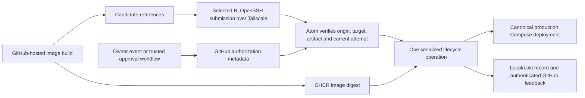

# CI deployment transport decision

* **Date:** 2026-11-02
* **State:** Owner selected profile B — restricted OpenSSH submission over Tailscale, with the common GHCR/approval components (D-26). Implementation and validation remain pending.
* **Context:** [Confirmed authorization rule](ci-authorization.md), [approved brief](../../concepts_brief.md), and [design draft](../../design_draft.md).

## Selected profile

The owner selected B: standard GitHub-hosted VMs build images, and a separate deployment job submits bounded requests through restricted OpenSSH over Tailscale to the Atom. The selection includes the common GHCR registry and private owner-controlled approval workflow below. The Atom independently verifies authorization before its trusted executor changes a service. A remains the unselected polling alternative. No CI installation on the second server or general home-network access for builds is selected.

The owner has confirmed that an eligible owner push/rerun authorizes its entire selected revision, including collaborator commits. A collaborator-originated run still needs the owner's explicit authorization. In both profiles, production-side verification checks actual GitHub metadata, source/build/approval identity, intended target, successful checks, and the fixed image digest. The transport alone is never deployment authorization.

## Common components selected with B

| Component | Selected mechanism and reason | Boundary or prerequisite |
| --- | --- | --- |
| Image registry | Use GHCR for images built by these Actions workflows, with repository-associated publishing permissions and fixed digest references. | Keep ITskolar images private and verify package access explicitly. Do not make private code/images public to avoid allowance limits. This does not mirror every vendor image into GHCR or remove the existing local registry before its consumers are inventoried. |
| Explicit collaborator-run approval | Add one private approval repository whose workflow/configuration can be changed only by the owner. The owner runs its fixed approval workflow with the source/build/attempt/artifact/digest and intended service. The workflow produces a bounded approval record. | No application checkout, dependency install, or build runs in this approval job. Keep collaborator write access and third-party Contents-write automation out of this repository. Production verifies the owner, enrolled workflow/ref, approval record, and referenced build; a file merely claiming approval is insufficient. |
| Owner-initiated runs | A successful eligible source build can produce a deployment candidate without a separate approval action under D-25. | The Atom verifies the actual current initiator and enrolled target. Candidate-supplied actor fields are not proof, and a later collaborator rerun cannot inherit new deployment authority. |
| Production verifier/executor | A bounded host-controlled operation validates the request, serializes lifecycle changes, pulls the selected digest, and runs the canonical production Compose configuration. | Accept data identifiers only. Do not execute request-supplied shell, source an application `.env` as shell code, or replace privileged host configuration with a collaborator-editable Compose file. Enrollment/configuration changes remain an explicit administrative action. |
| GitHub metadata access and feedback | Use a narrowly installed GitHub App on the Atom for required private run/artifact reads and selected deployment/check feedback. | Its key and permissions stay outside build jobs. Grant only needed repositories/API capabilities, with no source/workflow write permission. Verify installation access in both organizations and the approval repository. |
| Registry read access on the Atom | Provide a separate pull-only credential, delivered as protected active input, and inventory the packages its account can actually access. | Do not assume a GitHub App metadata token authenticates to GHCR or that a classic PAT is individually resource-scoped like a fine-grained repository token. Verify supported token type, account/package permissions, organization requirements, expiry/revocation, and recovery. Build publishing uses the repository's appropriately scoped `GITHUB_TOKEN`, not runtime application secrets. |
| Status and recovery | Retain request, source, approval, image/configuration identity, observed lifecycle result, readiness, and recovery outcome locally and through Loki; report the result to GitHub. | A queued or uploaded request is not a successful deployment. Secrets stay in host-controlled delivery inputs; pending secret versions must not be activated by a deployment. Keep last usable configuration/images/recovery points within the measured retention budget. |

The private approval repository avoids assuming private-repository environment reviewers are available. GitHub provides an owner-initiated [manual workflow dispatch](https://docs.github.com/en/actions/how-tos/manage-workflow-runs/manually-run-a-workflow); the trusted workflow must exist on its default branch, and production must allow only the enrolled trusted ref/revision. A caller cannot choose an arbitrary workflow branch as an approval authority.

GitHub documents workflow-token publishing, classic-token package authentication, per-package access, and [pulling images by digest](https://docs.github.com/en/packages/working-with-a-github-packages-registry/working-with-the-container-registry). Its [Packages billing page](https://docs.github.com/en/billing/concepts/product-billing/github-packages) currently states that Container registry image storage/bandwidth are free. That exception does not make private Actions compute, artifacts, or caches unlimited. Recheck actual plans, usage, retention, and spending controls before implementation; no paid overages or permanent pricing guarantee is assumed.

## Transport alternatives compared

| | A — Atom polls GitHub | B — Restricted SSH submission over Tailscale |
| --- | --- | --- |
| Mechanism | A systemd timer starts a bounded operation on the Atom to discover eligible candidate/approval records through GitHub APIs, validate them, and apply the selected deployment. | A separate hosted deployment job joins a narrowly permitted Tailscale identity and submits a bounded request over OpenSSH to a dedicated unprivileged identity on the Atom. The Atom performs the same independent verification before execution. |
| Home-network access | No CI network identity or inbound deployment endpoint is required. The Atom makes outbound GitHub/registry requests. | Grant the CI identity access only to the Atom's designated OpenSSH submission port, not general LAN routing, other servers, databases, or internal administration. D-26 selects this narrow machine-access addition. |
| Credentials exposed to jobs | Builds receive only their build/publish permissions. The approval job uses its own repository workflow token; production API/registry credentials remain on the Atom. | Add a project-scoped SSH submission credential to the deployment path and a bounded Tailscale federation configuration. The SSH credential permits request submission, not a shell or deployment without verified owner authority. Builds receive no production Docker or runtime-secret access. |
| Operating cost | Maintain a timer, read permissions, bounded discovery/state, and feedback. Normal latency includes the polling interval. API/rate/retention behavior needs measurement. | Maintain Tailscale federation/tag rules, OpenSSH identity/forced command, key rotation/recovery, rate limits, and connection handling. Submission can start promptly when the job reaches that step. |
| GitHub workflow result | The deployment job waits for bounded, authenticated controller feedback; cancellation/expiry must be checked before applying a waiting request. Include any waiting job cost in the private compute budget. | The request channel can wait for the recorded result; a connection loss requires status reconciliation under the same request identity. A successful SSH connection alone is not deployment success. |
| Failure conditions | GitHub discovery/private-read access fails, the controller/timer is down, the request expires, or the response cannot be verified. Defer without changing the running deployment; never treat missing approval metadata as permission. | Tailscale/identity access fails, SSH trust/permissions drift, or a submission credential is overprivileged. Defer on transport/verification failure. Security must still hold if an untrusted workflow obtains the submission credential. |
| Recovery and idempotency | Resume a recorded operation by ID; discard/reject consumed or superseded requests so a timer restart cannot replay a deployment or roll back a newer release. | The same operation ID/ledger applies. Reconnecting or resubmitting cannot create a new authorization, repeat a completed mutation, or hide an uncertain in-progress result. |

B is selected but not implemented or benchmarked. An HTTP webhook/API service, a full deployment dashboard, or an additional queue platform is not required; keep orchestration limited to these known operations and native systemd/OpenSSH/GitHub components.

## Option B's submission boundary

Use ordinary OpenSSH over Tailscale, so OpenSSH key restrictions apply. Keep a dedicated identity outside the Docker group with no arbitrary sudo or login shell access through this credential. Root-managed key/configuration policy forces a fixed submission command, disables forwarding/PTY/user rc behavior, and binds each project credential to its enrolled service/repository scope. Ignore the client-supplied shell command; parse bounded request data instead.

Treat possession of the submission key as an untrusted ability to ask, not proof of owner approval. An application workflow editor might obtain a repository secret regardless of the nominal job name. Therefore, a leaked submission key must still fail to change state for an unapproved source/attempt/target, reveal runtime inputs, replace configuration, or run arbitrary commands. Test this boundary directly; do not put a general production SSH/deployment key into an application repository and rely on a later YAML condition.

The privileged executor and configuration remain outside the submitter's write access. Bound request size/rate, safe queue/ledger access, and output fields; correlate every accepted/rejected request without logging credentials. No Docker TCP endpoint or broad home-network route is added.

Debian's [OpenSSH manual](https://manpages.debian.org/trixie/openssh-server/sshd.8.en.html) describes key-forced commands and `restrict`, including forwarding/PTY restrictions. Tailscale documents [GitHub workload identity federation and ephemeral nodes](https://tailscale.com/docs/integrations/github/github-action). Its tag policy still needs configuration and actual allowed/denied reachability tests; an ephemeral node alone does not establish narrow network access. Federation avoids an additional long-lived tailnet enrollment secret but does not remove the SSH submission credential or host-side authorization check.

## Cutover and validation for the selected profile

1. Inventory actual repositories, production refs, workflow identities, images/package permissions, existing runner assignments, and current production Compose inputs. Verify plans/compute usage and the metadata/feedback credentials without changing permissions silently.
2. Build and publish a harmless fixture image/request using hosted VMs. Verify private access, fixed digest mapping, and the owner-only approval workflow without granting production execution yet.
3. Exercise the host verifier against the [authorization matrix](ci-authorization.md): owner/collaborator pushes and reruns, including an originally owner-initiated run rerun by a collaborator. Include source/approval/build tuple mismatch, forged actor fields, partial reruns, cancellation, expiration, replay, and unavailable GitHub APIs.
4. Test B's transport failure and trust boundaries: reject forbidden SSH operations, hostile request data, out-of-scope project requests, and unauthorized private-network paths even when submission credentials are known. Cover GitHub metadata pagination/rate limits and broken or expired transport credentials.
5. Adopt one external service with a tested data/configuration recovery point. Pin its actual production configuration and active inputs, apply an authorized digest, and verify real consumer readiness and result reporting. Include concurrent secret activation/updater attempts to prove serialization and pending-secret isolation.
6. Remove or restrict competing old self-hosted runner/deployment authority as part of the controlled cutover. Do not leave an old broad-privilege workflow as an undocumented backup path. Keep a documented admin recovery operation using known approved configuration and data.
7. Test registry/metadata/Vault outages, missed feedback, interruption after replacement, and restore of the operation ledger. Return the observed state rather than blindly retrying or pretending an image rollback reverses a data migration.

Detailed filenames, command interfaces, permission sets, request/connection deadlines, and retention will be finalized for B in the Technical Plan and Detailed Implementation. This decision does not broaden application secret access, change startup code, or authorize live repository/tailnet/host changes during this design phase.
